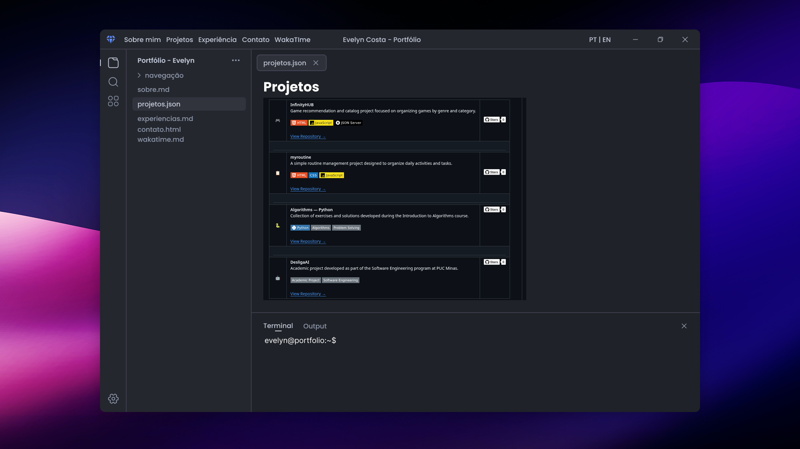
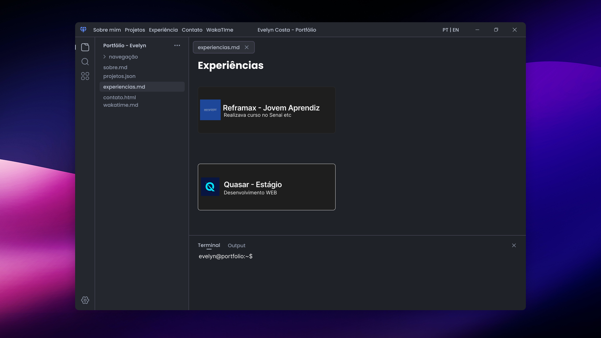
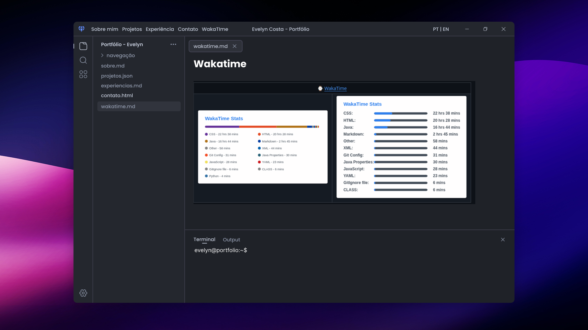
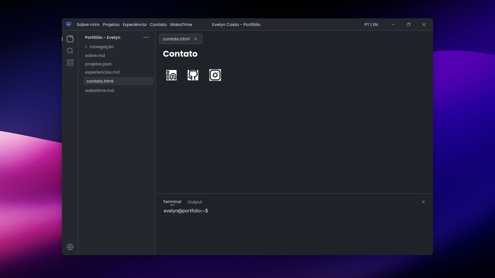

# 💻 Portfólio Profissional — Evelyn Costa

Portfólio profissional desenvolvido para apresentar minha trajetória, experiências, habilidades e projetos atuais e futuros.

A interface é inspirada no Visual Studio Code: cada seção é representada por um arquivo, que poderá ser acessado pelo menu, explorador lateral ou terminal interativo.

Projeto acadêmico da disciplina de Desenvolvimento e Integração de Aplicações Web (DIAW), do curso de Engenharia de Software da PUC Minas.

## 📌 Status do projeto

**Sprint 01: planejamento, prototipação e estrutura inicial do front-end.**

Os itens abaixo representam o planejamento do projeto; as funcionalidades serão implementadas ao longo das sprints.

## 🎯 Objetivo

Criar um site responsivo com identidade visual própria, permitindo que visitantes conheçam minha formação, atuação profissional, interesses, objetivos e projetos por meio de uma navegação inspirada em um editor de código (VSCODE).

## 🗂️ Seções previstas

| Seção | Arquivo na interface | Conteúdo previsto |
| --- | --- | --- |
| Sobre mim | `sobre.md` | Apresentação em português e inglês, formação, atuação, interesses e objetivos profissionais. |
| Projetos | `projetos.json` | Linha do tempo do mais antigo ao mais recente, com nome, descrição, tecnologias, repositório e imagem ou GIF de cada projeto. |
| Experiências | `experiencias.md` | Empresa ou instituição, cargo ou atividade, período e descrição das experiências. |
| Contato | `contato.html` | Links de contato e formulário com nome, e-mail e mensagem. |
| WakaTime | `wakatime.md` | Espaço planejado para estatísticas de programação; integração a definir. |
| Recomendações | `recomendacoes.md` | Espaço planejado para recomendações profissionais autorizadas. |

Os nomes dos arquivos são elementos da interface e não precisam corresponder aos arquivos físicos do projeto.

## 🎨 Protótipo

O protótipo inicial foi elaborado no Figma a partir de um modelo da comunidade inspirado no VSCode, adaptado à identidade e ao conteúdo do portfólio.

🔗 [Acessar o projeto no Figma](https://www.figma.com/design/SCh7pN4kav3GJIBInlOyKO/Evelyn---Portf%C3%B3lio?node-id=0-1&t=pd9OAWmRXw0VBR3h-1)

### Telas do protótipo

**Sobre mim**


**Projetos**



**Experiências**



**WakaTime**



**Contato**



### Organização visual

- Cabeçalho com identificação, navegação e seletor de idioma.
- Explorador lateral com os arquivos que representam as seções.
- Abas com indicação da seção aberta.
- Área principal para apresentação do conteúdo.
- Terminal interativo e rodapé com identificação e links.
- Adaptação da interface para desktop e dispositivos móveis.

## ⌨️ Terminal interativo

O terminal permitirá acessar as mesmas seções disponíveis no menu. A proposta inicial inclui os seguintes comandos:

| Comando | Ação prevista |
| --- | --- |
| `ajuda` | Exibe os comandos e arquivos disponíveis. |
| `sobre.md` | Abre a seção Sobre mim. |
| `projetos.json` | Abre a seção Projetos. |
| `experiencias.md` | Abre a seção Experiências. |
| `contato.html` | Abre a seção Contato. |
| `wakatime.md` | Abre a seção WakaTime. |
| `recomendacoes.md` | Abre a seção Recomendações. |
| `limpar` | Limpa o histórico do terminal. |

O terminal será uma simulação de navegação no navegador, sem executar comandos do sistema operacional.

## 🛠️ Tecnologias previstas

| Tecnologia | Finalidade |
| --- | --- |
| React | Construção da interface com componentes reutilizáveis e gerenciamento do estado da navegação, abas e terminal. |
| Vite | Configuração do ambiente de desenvolvimento, servidor local e geração da versão de produção. |
| HTML5 | Estrutura e marcação semântica da interface, utilizadas nos componentes por meio de JSX. |
| CSS3 | Estilização, layout e responsividade. |
| JavaScript | Navegação, terminal e interações da interface. |
| Node.js e npm | Ambiente para executar as ferramentas de desenvolvimento e gerenciar as dependências. |
| Figma | Planejamento e prototipação visual. |
| Git e GitHub | Versionamento e hospedagem do repositório. |

O front-end será desenvolvido em React com JavaScript e Vite. Bibliotecas adicionais, serviço de envio de e-mail, integração com WakaTime e hospedagem serão definidos conforme a evolução do projeto. As dependências efetivamente utilizadas serão documentadas neste README.

## 📁 Estrutura inicial prevista

```text
portfolio/
├── index.html
├── package.json
├── package-lock.json
├── vite.config.js
├── README.md
├── public/
├── src/
│   ├── main.jsx
│   ├── App.jsx
│   ├── assets/
│   │   └── images/
│   ├── components/
│   │   ├── Header.jsx
│   │   ├── Explorer.jsx
│   │   ├── Tabs.jsx
│   │   ├── Terminal.jsx
│   │   └── Footer.jsx
│   ├── sections/
│   │   ├── Sobre.jsx
│   │   ├── Projetos.jsx
│   │   ├── Experiencias.jsx
│   │   ├── Contato.jsx
│   │   ├── WakaTime.jsx
│   │   └── Recomendacoes.jsx
│   └── styles/
│       └── global.css
└── docs/
    └── prototipofigma/
        ├── Sobre mim.png
        ├── Projetos.png
        ├── Experiência.png
        ├── Contato.png
        └── Wakatime.png
```

O arquivo `main.jsx` inicializará a aplicação React, e `App.jsx` organizará os componentes e a seção selecionada. A pasta `components/` reunirá os elementos compartilhados da interface, enquanto `sections/` conterá os conteúdos de cada arquivo do portfólio.

## 🚀 Execução local

### Pré-requisitos

- Node.js em uma versão compatível com o Vite utilizado no projeto.
- npm.
- Navegador atualizado.

### Instalação e execução

Após a criação do front-end inicial, clone ou baixe o repositório e abra um terminal na pasta do projeto.

Instale as dependências:

```bash
npm install
```

Inicie o servidor de desenvolvimento:

```bash
npm run dev
```

Abra no navegador o endereço informado no terminal pelo Vite.

Para gerar a versão de produção:

```bash
npm run build
```

Para visualizar localmente a versão gerada:

```bash
npm run preview
```

Os comandos acima correspondem à configuração prevista para React com Vite e serão confirmados após a criação do front-end inicial.

## 🗓️ Planejamento das entregas

### Sprint 01 — Planejamento e prototipação

- Criação do repositório e README inicial.
- Wireframes de média fidelidade no Figma.
- Protótipo inicial do front-end.
- Implementação da navegação e do layout principal.
- Inclusão das imagens dos protótipos e da estrutura prevista no README.

### Sprint 02 — Funcionalidades principais

- Apresentação em português e inglês.
- Timeline dinâmica de projetos.
- Organização das experiências profissionais.
- Links de contato e formulário com envio de e-mail.
- Validações básicas e responsividade.

### Sprint 03 — Hospedagem e finalização

- Publicação do site na nuvem.
- Ajustes visuais e de usabilidade.
- Inclusão de imagens ou GIFs dos projetos em funcionamento.
- Atualização do README com dependências, instruções e link do site.

## 📦 Implantação

Hospedagem e endereço público ainda não definidos. O link de acesso será incluído após o deploy.

## ✒️ Autora

**Evelyn Costa** — estudante de Engenharia de Software na PUC Minas.

[GitHub](https://github.com/Evycostzocn)

## 💡 Referências

- Modelo visual: **Diamond — VSCode Inspired Code Editor Design** 🔗 [Acessar o projeto no Figma](https://www.figma.com/community/file/1247868281929098053/diamond-vscode-inspired-code-editor-design), disponível na comunidade do Figma e adaptado neste projeto.
- A proposta de navegação pelo terminal foi inspirada no portfólio do professor João Paulo Aramuni [GitHub](https://github.com/joaopauloaramuni).

## 📄 Licença

A licença do código deste projeto ainda será definida. As condições de uso e atribuição dos materiais de terceiros serão verificadas e respeitadas.